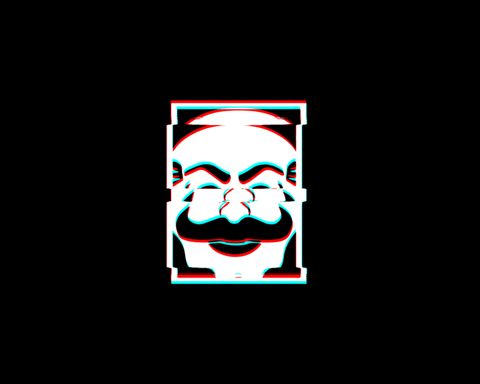

## olá, eu me chamo Ruan Alves

- 🌱 estou estudando e me especializando em java
- 📚 cursando sistemas da informação

  <kbd>
   
  </kbd>
  
  <kbd>
   
  </kbd>
  
  <kbd>
   
  </kbd>

  <kbd>
   
  </kbd> 
  

 ##

 

 <picture align="center">
  <source media="(prefers-color-scheme: dark)" 
          srcset="https://raw.githubusercontent.com/radsilva-dev/radsilva-dev/output/github-contribution-grid-snake-dark.svg">
  <source media="(prefers-color-scheme: light)" 
          srcset="https://raw.githubusercontent.com/radsilva-dev/radsilva-dev/output/github-contribution-grid-snake.svg">
  
</picture>

